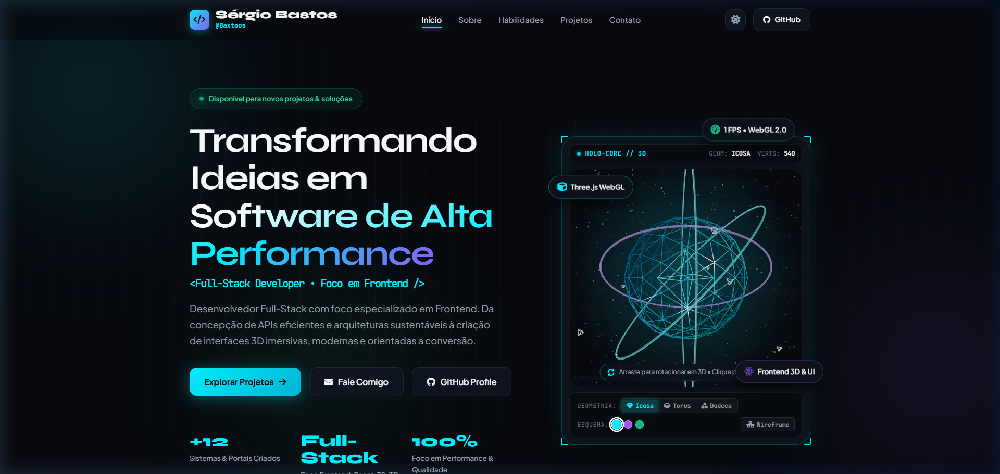

# Sérgio Bastos — Portfólio de Engenharia Full-Stack & Frontend

<div align="center">


<br />

<a href="https://baxtoos.github.io/portifolio/" target="_blank">
  
</a>

**Desenvolvedor Full-Stack (Foco em Frontend) & Bacharel em Ciência da Computação (IFSP)**  
*Construo interfaces de alta precisão e os sistemas que as sustentam.*

[Acesso em Produção](https://baxtoos.github.io/portifolio/) | [Perfil GitHub](https://github.com/Baxtoos) | [Contato](#contato)

</div>

---

## Direção de Design: Monografia Editorial de Engenharia (Moss Ink & CLI Edition)

O portfólio foi desenhado sob a disciplina **Impeccable First** (`PRODUCT.md` e `DESIGN.md`), priorizando clareza estrutural, tipografia autoral, inspeção interativa via linha de comando e prova imediata de sistemas reais em produção:

- **Inspeção via Linha de Comando no Hero (`baxtoos@dev:~$`)**: O terminal interativo ocupa o centro visual do Hero, com atalho global de teclado (`/`), autocompletar via `Tab`, chips de execução rápida em 1 clique e comandos capazes de abrir fichas técnicas de projetos (`open diex`, `open appfisio`, `open mtsublimacao`, `projects`, `skills`, `whoami`, `contact`).
- **Paleta Editorial "Verde Musgo & Tinta" (Dual-Theme)**: Tinta musgo profunda (`#0B100E`) no tema escuro padrão e papel sálvia arquival (`#F3F5F0`) no tema claro, acompanhados de um único acento verde esmeralda/floresta (`#2FBF8A` / `#14724F`) sem neon e sem gradientes, com contraste validado WCAG AA/AAA.
- **Tipografia com Ponto de Vista**: *Bricolage Grotesque* para títulos e display, *Manrope* para leitura contínua (medida de 65–68ch) e *JetBrains Mono* para o terminal CLI, métricas tabulares e identificadores de stack.
- **Hierarquia Guiada por Provas**: Três estudos de caso principais (*DIEX Tech Studio*, *AppFisio* e *MT Sublimação*) abrem a página logo após o Hero com análise estruturada (*Problema → Engenharia → Impacto*), seguidos pelo arquivo filtrável completo de 13 projetos.
- **Performance Zero-Build & Zero-WebGL Bloat**: Execução instantânea sem pacotes 3D pesados (~600 KB de JS poupados) e com SVGs vetoriais nativos inline (`1.75px` stroke).

---

## Tecnologias & Arquitetura

| Camada | Tecnologias Utilizadas |
| :--- | :--- |
| **Core** | HTML5 Semântico, CSS3 Custom Properties, JavaScript (ES6+) |
| **Inspeção Interativa** | Terminal CLI customizado (`baxtoos@dev:~`) com histórico, `Tab` autocomplete e atalho `/` |
| **Motion** | [GSAP 3.12 + ScrollTrigger](https://gsap.com/) com `gsap.matchMedia()` |
| **Tipografia & Ícones** | *Bricolage Grotesque*, *Manrope*, *JetBrains Mono* + SVGs vetoriais inline (`1.75px` stroke) |
| **Governança de Design** | `PRODUCT.md`, `DESIGN.md` e `.impeccable/surfaces/index-html.md` |

---

## Estrutura do Repositório

```bash
portifolio/
|-- index.html                  # Documento principal (semântico, acessível, SEO/JSON-LD)
|-- PRODUCT.md                  # Verdade de produto, público e restrições técnicas
|-- DESIGN.md                   # Sistema de design, tokens de cor, escala tipográfica e regras
|-- assets/
|   |-- css/
|   |   `-- style.css           # Design system completo (Verde Musgo & Papel Sálvia)
|   |-- js/
|   |   |-- main.js             # Terminal CLI no Hero, estudos de caso, filtros, modal e GSAP
|   |   `-- projects-data.js    # Base de dados dos 13 projetos e matriz de capacidades
|   `-- images/
|       `-- projects/           # Previews verificados dos sistemas em produção
`-- README.md                   # Documentação do repositório
```

---

## Estudos de Caso Principais

1. **DIEX Tech Studio & Ecossistema Digital**: [diex-site.vercel.app](https://diex-site.vercel.app) — Estúdio de tecnologia e ecossistema com +12 sistemas e portais entregues (*React, TypeScript, Node.js, Supabase, < 0.8s FCP*).
2. **AppFisio (SaaS Clínico)**: [appfisio.vercel.app](https://appfisio.vercel.app) — Plataforma Full-Stack para gestão de prontuários eletrônicos e reabilitação motora (*Node.js, Express, Prisma ORM, SQLite/PostgreSQL*).
3. **MT Sublimação & Brindes Corporativos**: [mtsublimacao.vercel.app](https://mtsublimacao.vercel.app) — Catálogo dinâmico com redução de 60% no tempo de fechamento de orçamentos via WhatsApp (*React, TypeScript, Tailwind CSS*).

---

## Contato

- **Desenvolvedor**: Sérgio Bastos da Silva Filho
- **GitHub**: [@Baxtoos](https://github.com/Baxtoos)
- **E-mail**: [giftc444@gmail.com](mailto:giftc444@gmail.com)
- **Localização**: Salto / Indaiatuba — SP, Brasil
