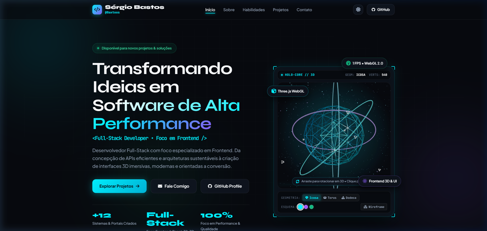

# Sérgio Bastos - Portfólio Profissional Full-Stack (Foco em Frontend)

<div align="center">


<br />

<a href="https://baxtoos.github.io/portifolio/" target="_blank">
  
</a>

**Desenvolvedor Full-Stack (Foco em Frontend) & Engenheiro de Software**  
*Especialista em interfaces modernas de alta performance e experiências web ricas com sustentação de ponta a ponta.*

[🚀 Acessar Demonstração Ao Vivo (GitHub Pages)](https://baxtoos.github.io/portifolio/) | [Perfil GitHub](https://github.com/Baxtoos) | [Contato](#contato)

</div>

---

## Funcionalidades em Destaque

- **Banner Holográfico 3D Interativo (Three.js WebGL 2.0)**: Renderização tridimensional em tempo real no hero com controle de órbita 360 por clique/arraste, alternador de geometrias (Icosaedro, Torus Knot, Dodecaedro), seletor de paletas neon, modo wireframe/sólido e telemetria de GPU ao vivo (FPS real, contagem dinâmica de vértices).
- **Performance Extrema & Zero Build**: Roda nativamente em qualquer navegador ou servidor estático (GitHub Pages, Vercel, Netlify).
- **Design System Obsidian**: Efeito Glassmorphism com `backdrop-filter`, orbes dinâmicos de luz no plano de fundo, badges cibernéticos e tipografia de ponta (*Syne*, *Plus Jakarta Sans*, *JetBrains Mono*).
- **Terminal Interativo Integrado**: Widget de terminal estilo Unix (`baxtoos@dev:~$`) com histórico de comandos (setas Cima/Baixo) e comandos interativos (`help`, `whoami`, `frontend`, `backend`, `skills`, `projects`, `diex`, `contact`, `clear`).
- **Showcase Filtrável de Projetos**: Filtros dinâmicos em tempo real por categoria (*Full-Stack*, *Engenharia & Java*, *Frontend*, *Landing Pages B2B*).
- **Modal Imersivo de Especificação Técnica**: Cada projeto conta com ficha completa acessível (Visão Geral, Métricas, Tags da Stack, links de demonstração e código).
- **Copy E-mail com Toast Feedback**: Copia o endereço `giftc444@gmail.com` com um clique e feedback animado gerenciado.
- **Suporte a Temas (Dark / Light)**: Alternância suave com persistência no `localStorage`.
- **Animações de Clique e Redirecionamento**: Feedback tátil com efeito de ondulação radial neon e barra de progresso suave no topo.
- **100% Responsivo & Acessível**: Layout semântico otimizado para celulares, tablets e monitores ultrawide com suporte a navegação por teclado e SEO estruturado (JSON-LD).

---

## Tecnologias & Fundamentos

| Camada | Tecnologias Utilizadas |
| :--- | :--- |
| **Frontend Core** | HTML5, CSS3 e JavaScript |
| **3D & WebGL** | [Three.js r128](https://threejs.org/) |
| **Estilização** | Design System Proprietário Obsidian/Cyan, Glassmorphism, Micro-interações |
| **Motion** | [GSAP 3](https://greensock.com/gsap/) |
| **Tipografia & Ícones** | Google Fonts e FontAwesome 6 |

---

## Estrutura do Repositório

```bash
portifolio/
|-- index.html                  # Estrutura principal
|-- assets/
|   |-- css/
|   |   `-- style.css           # Design system completo
|   |-- js/
|   |   |-- hero-3d.js          # Motor 3D WebGL Three.js, física orbital e HUD interativo
|   |   |-- main.js             # Lógica interativa
|   |   |-- projects-data.js    # Dados dos projetos
|   |   `-- vendor/
|   |       `-- three.min.js    # Three.js r128 local para carregamento offline
|   `-- images/
|       `-- projects/           # Imagens dos projetos
|-- README.md                   # Documentação do repositório
`-- PROFILE_README.md           # Template para o perfil do GitHub
```

---

## Projetos em Destaque

1. **AppFisio (SaaS Full-Stack)**: [appfisio.vercel.app](https://appfisio.vercel.app) - Gestão clínica para fisioterapeutas com prescrição de exercícios e prontuário digital (*Node.js, Express, Prisma ORM, SQLite/PostgreSQL*).
2. **MT Sublimação & Brindes**: [mtsublimacao.vercel.app](https://mtsublimacao.vercel.app) - Catálogo virtual interativo com cotação automatizada e despacho para WhatsApp (*React, TypeScript, Tailwind*).
3. **Crucciolli Print3D**: [crucolli-lp.vercel.app](https://crucolli-lp.vercel.app) - Portal de manufatura de impressão 3D e prototipagem (*React, Three.js Specs, Vite*).
4. **Smoke Salto Adega & Delivery**: [smoke-salto.vercel.app](https://smoke-salto.vercel.app) - E-commerce e vitrine digital com busca em tempo real (*React, Vite, Dark UI*).
5. **Detailing Delivery**: [automotive-detailing-two.vercel.app](https://automotive-detailing-two.vercel.app) - Estética automotiva.
6. **MR Galvanoplastia**: [lp-mrgalvanoplastia.vercel.app](https://lp-mrgalvanoplastia.vercel.app) - Landing page para indústria de revestimentos galvânicos e normas automotivas.
7. **GELOU Fábrica de Gelo**: [lp-gelou.vercel.app](https://lp-gelou.vercel.app) - Plataforma digital para fábrica e distribuição comercial de gelo.
8. **Talismã Consultoria Imobiliária**: [generical-site-imobiliaria-sergio-bastos-projects-01da1aa3.vercel.app](https://generical-site-imobiliaria-sergio-bastos-projects-01da1aa3.vercel.app) - Portal imobiliário de alto padrão em Indaiatuba.
9. **STL Lima 3D**: [stl-lima-lp.vercel.app](https://stl-lima-lp.vercel.app) - Manufatura aditiva e modelagem de peças mecânicas sob medida.
10. **Industrial Automation**: [industrial-autom.vercel.app](https://industrial-autom.vercel.app) - Soluções industriais, automação fabril e painéis elétricos.
11. **EventHub (Arquitetura Java)**: [github.com/Baxtoos/event-hub](https://github.com/Baxtoos/event-hub) - Gestão de eventos, lotes de ingressos e controle de acesso (*Java, Spring Boot, JPA/Hibernate, MVC*).
12. **CarTon**: [github.com/Baxtoos/CarTon](https://github.com/Baxtoos/CarTon) - Gestão operacional de oficinas mecânicas com ciclo de vida completo de engenharia de software e modelagem UML.

---

## Contato

- **Desenvolvedor**: Sérgio Bastos da Silva Filho
- **GitHub**: [@Baxtoos](https://github.com/Baxtoos)
- **E-mail**: [giftc444@gmail.com](mailto:giftc444@gmail.com)
- **Localização**: Salto / Indaiatuba - SP, Brasil

---

<div align="center">
  <sub>Desenvolvido por Sérgio Bastos - 2026</sub>
</div>
